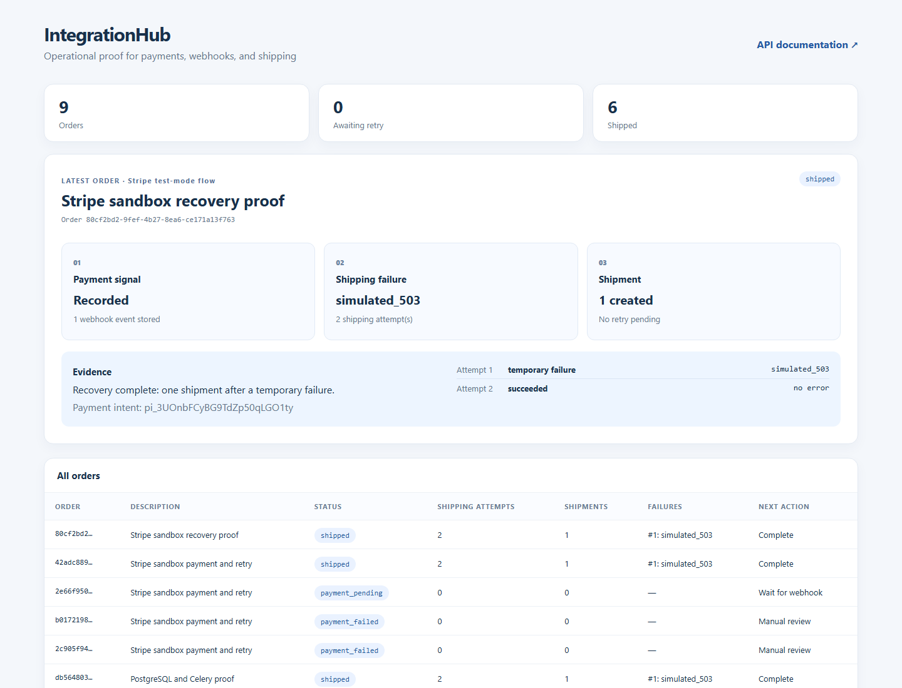

# IntegrationHub

An integration case study for orders, **Stripe test-mode payments**, verified webhooks, queued simulated shipping, auditable retries, and an operations dashboard.

**Client problem:** A payment succeeds, shipping fails, and the same webhook arrives again. The order must recover without creating a second shipment. **Recorded result:** one temporary shipping failure, one successful retry, and exactly one shipment. [Watch the 23-second Stripe test-mode video](media/stripe-sandbox-demo.mp4) or [read the Upwork portfolio copy](portfolio/upwork_item.md).

## Public interactive demo

[Explore the browser demo](https://zoberobe.github.io/IntegrationHub/) to step through a temporary shipping failure, recovery, and duplicate webhook. It is a clearly labeled local simulation; the real Stripe test-mode evidence is below. The demo source is in [`docs/`](docs/).

## Watch the verified Stripe sandbox flow

[](media/stripe-sandbox-demo.mp4)

The [23-second sandbox video](media/stripe-sandbox-demo.mp4) shows a Stripe test-mode payment, a signed CLI-forwarded webhook, a temporary shipping failure, a successful retry, and exactly one shipment. The [payment audit](media/stripe-payment-audit.json) and [same-event replay proof](media/stripe-sandbox-proof.json) document the result. A second run with a rotated restricted test key has its own [audit](media/stripe-rotated-key-audit.json) and [replay proof](media/stripe-rotated-key-replay.json). Shipping is simulated.

## Run the project

1. Copy `.env.example` to `.env`. Replace `STRIPE_SECRET_KEY` with an `sk_test_...` or `rk_test_...` key from your Stripe account. A restricted key needs Payment Intents write/read and Events read permissions. Never use a live key with this project.
2. In another terminal, run `stripe listen --forward-to localhost:54321/webhooks/stripe`. Copy the displayed `whsec_...` value to `STRIPE_WEBHOOK_SECRET` in `.env`. The [Stripe CLI](https://docs.stripe.com/stripe-cli) must be installed and authenticated.
3. Run `docker compose up --build -d`. If you change `.env` after startup, run `docker compose up -d --force-recreate api worker beat`.
4. Open the [API documentation](http://localhost:54321/docs) and [operations dashboard](http://localhost:54321/dashboard). Swagger UI assets are served locally.

The database tables are created when the API starts. This is a local demonstration environment; it does not include authentication or production database migrations.

## Controlled demonstration

In PowerShell:

```powershell
$order = Invoke-RestMethod http://localhost:54321/orders -Method Post -ContentType 'application/json' -Body '{"amount":2500,"currency":"brl","description":"Demo order","shipping_fail_once":true}'
Invoke-RestMethod "http://localhost:54321/orders/$($order.id)/payment" -Method Post
```

The payment adapter confirms a test PaymentIntent with `pm_card_visa`. Stripe sends `payment_intent.succeeded` to the local listener. The verified webhook changes the order to `shipping_pending`. Celery Beat finds the persisted job, and the worker makes the first shipping attempt. The simulation returns `simulated_503` **before** creating a shipment. After the configured delay, the second attempt creates a shipment and the order reaches `shipped`.

```powershell
Invoke-RestMethod "http://localhost:54321/orders/$($order.id)" | ConvertTo-Json -Depth 8
```

The response should show two shipping attempts, one `shipment_id`, state `shipped`, and `next_action=complete`. The dashboard displays the failure and scheduled retry. The automated test delivers the same webhook twice and invokes the task again after success; only one row exists in `simulated_shipments`.

To inspect the shipment count directly:

```powershell
docker compose exec db psql -U integrationhub -d integrationhub -c 'select order_id, count(*) from simulated_shipments group by order_id;'
```

## States and transitions

| State | Trigger | Next action |
| --- | --- | --- |
| `awaiting_payment` | Order created | Start payment |
| `payment_pending` | Payment request started or timed out | Wait for webhook or retry with the same key |
| `payment_failed` | Permanent payment failure | Manual review |
| `shipping_pending` | Verified payment-success webhook | Worker creates shipment |
| `shipping_retrying` | Temporary shipping failure | Wait until `due_at` |
| `shipping_failed` | Permanent failure or retry limit reached | Manual review |
| `shipped` | Shipment created | Complete |

`paid` is reserved in the domain enum. The webhook atomically transitions straight to `shipping_pending` while creating the shipping job.

## Reliability and observability

- Each order has a stable payment idempotency key, reused on repeated requests. PaymentIntent creation sends it in the `Idempotency-Key` header. If the outcome remains uncertain for 23 hours, the API requires manual reconciliation before another request because [Stripe can remove keys after at least 24 hours](https://docs.stripe.com/api/idempotent_requests).
- Webhooks verify the raw-body HMAC SHA-256 signature, a timestamp within five minutes, and the PaymentIntent ID, amount, and currency. `webhook_events.id` is unique, so duplicate delivery does not advance the order twice.
- Shipping uses a stable key per order, and `simulated_shipments` enforces uniqueness. The worker locks the order row in PostgreSQL before checking its state, so duplicate task delivery cannot create another shipment.
- The webhook state change and shipping job are committed in one database transaction. Celery Beat scans due jobs every five seconds, including jobs left behind by a Redis or API interruption.
- Stripe requests have an eight-second timeout. Temporary shipping failures use exponential delays of five and ten seconds, with a maximum of three attempts. Permanent failures are not retried automatically.
- `integration_attempts` records a controlled error code, attempt number, and next retry time. Stripe response bodies and secrets are not stored in logs or the database.

## Tests

```powershell
python -m venv .venv
.\.venv\Scripts\python -m pip install -r requirements.txt
.\.venv\Scripts\python -m pytest -q
```

The nine test cases cover duplicate webhooks, signature rejection, payment timeouts and idempotency, temporary shipping failure and recovery, duplicate task delivery, the retry limit, the sandbox request shape, and the HTTP API. They use in-memory SQLite for domain rules. The local PostgreSQL/Redis/Celery path, a four-call PostgreSQL row-lock check, and a real Stripe test-mode payment were verified separately.

GitHub Actions runs these nine SQLite tests on pushes to `main` and on pull requests. This CI job does not run the Docker stack or make Stripe calls; use [VALIDATION.md](VALIDATION.md) for those separate checks.

## Validation status

- Offline domain and API tests: 9 passing.
- PostgreSQL, Redis, API, worker, and Beat: verified with Docker Compose on 2026-10-09. The [saved full-stack proof](media/fullstack-proof.json) shows a processed and duplicate signed webhook, a temporary shipping failure followed by success, two skipped duplicate tasks, one webhook event, and exactly one shipment. Reproduce it with [VALIDATION.md](VALIDATION.md).
- PostgreSQL concurrent shipping check: four calls produced one shipment and one shipping attempt; the other three calls were skipped. See the [saved concurrency proof](media/concurrency-proof.json).
- Restricted test key (`rk_test_`) rerun: verified on 2026-10-09. The [new payment audit](media/stripe-rotated-key-audit.json) and [same-event replay](media/stripe-rotated-key-replay.json) confirm a succeeded non-live PaymentIntent, a signed CLI-forwarded webhook, temporary shipping failure, recovery, and exactly one shipment.
- Stripe test-mode payment and signed CLI-forwarded webhook: verified on 2026-10-09. The [payment audit](media/stripe-payment-audit.json) confirms a succeeded, non-live PaymentIntent, one temporary shipping failure, one successful retry, and one shipment. The [same-event replay](media/stripe-sandbox-proof.json) returned duplicate without changing the event or shipment counts. The replay fetched the Stripe-origin event and signed the local request with the active CLI listener secret.

## Presentation material

A 45–60 second walkthrough can show: `/docs`; creating an order with `shipping_fail_once=true`; starting the payment; the Stripe listener receiving the webhook; `/dashboard` in `shipping_retrying`; the transition to `shipped`; two attempts in the order history; and a `simulated_shipments` count of one. Use fictional order data.

The repository includes a [23-second silent Stripe sandbox video](media/stripe-sandbox-demo.mp4) and [retry](media/stripe-retry.png) / [success](media/stripe-success.png) captures from the real test-mode run. It also includes a [local full-stack dashboard capture](media/fullstack-dashboard.png), a [saved recovery proof](media/fullstack-proof.json), a [concurrency proof](media/concurrency-proof.json), a [15-second silent offline preview](media/demo.webm), and three offline screenshots: [API documentation](media/api.png), [temporary failure](media/retry.png), and [recovery](media/success.png). The original three screenshots and video were generated with `scripts/demo_offline.py`. The full-stack dashboard capture uses PostgreSQL, Redis, Celery, and a locally signed webhook. The Stripe sandbox video and captures use an actual Stripe test-mode PaymentIntent and a CLI-forwarded signed webhook. The replay was signed locally to prove that the same Stripe event ID is idempotent. Install [requirements-media.txt](requirements-media.txt) and run `python -m scripts.render_stripe_video` to regenerate the sandbox video from its captures and proof.

## Integration references

- [Create a PaymentIntent](https://docs.stripe.com/api/payment_intents/create)
- [Idempotency keys](https://docs.stripe.com/api/idempotent_requests)
- [Test payment methods](https://docs.stripe.com/testing)
- [Webhook signatures](https://docs.stripe.com/webhooks/signature)
